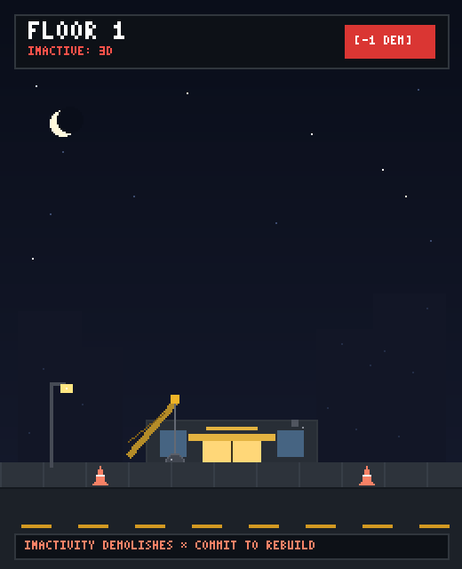

<h1 align="center">Hi there, I'm Dinesh 👋</h1>

  <b>Building solutions with code • Powered by daily commits</b>

  

  <em>🏙️ <b>The Commit Tower:</b> A living skyscraper built dynamically by my GitHub activity. 
  Commits trigger active construction cranes & welding sparks • Inactivity brings the wrecking ball!</em>

---

### 🕹️ How It Works

| State | Trigger | Animation & Visuals |
| :--- | :--- | :--- |
| 🔨 **Constructing** | Active commits today | Yellow tower crane, hoisted steel girder, active welding sparks, +1 floor added |
| ⚠️ **Demolishing** | Inactive days | Demolition crane, swinging wrecking ball, crumbling masonry, -1 floor per day |
| 🏢 **Milestones** | Consecutive streaks | **Lobby** (Floor 1) → **Dev Suite** (Floor 2) → **Cloud Server Lab** (Floor 3) → **Sky Penthouse** (Floor 4+) |

---

### 🚀 Featured Projects
- **[RoadIQ](https://github.com/dineshdev-21/RoadIQ)** — Intelligent road analytics & computer vision system.
- **[Safari-Rag](https://github.com/dineshdev-21/Safari-Rag)** — Retrieval-Augmented Generation pipeline.
- **[my-portfolio](https://github.com/dineshdev-21/my-portfolio)** — Personal web portfolio & interactive showcases.
- **[lil-agents](https://github.com/dineshdev-21/lil-agents)** — Autonomous agent orchestration & multi-agent workflows.

---

  Automated nightly via GitHub Actions ⚡ Powered by custom procedural pixel engine

