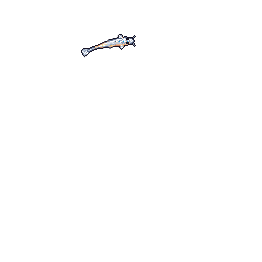

# Hi there, I'm Dinesh 👋

  
   
  <em>A pixel-art koi swimming in my GitHub pond, colored by my languages and grown by my contributions.</em>

---

### 🌊 About the Koi
This koi fish is dynamically drawn and updated every night by [`git-koi`](https://github.com/yalongwastaken/git-koi).
- **Body & Fins:** Grown from public contributions and streaks.
- **Colors:** Derived from repository language distribution.
- **Swim Pattern:** Changes daily based on the previous day's activity.

---

### 🚀 Projects & Work
- [RoadIQ](https://github.com/dineshdev-21/RoadIQ)
- [Safari-Rag](https://github.com/dineshdev-21/Safari-Rag)
- [my-portfolio](https://github.com/dineshdev-21/my-portfolio)
- [lil-agents](https://github.com/dineshdev-21/lil-agents)

---

  Powered by <a href="https://github.com/yalongwastaken/git-koi">git-koi</a>

